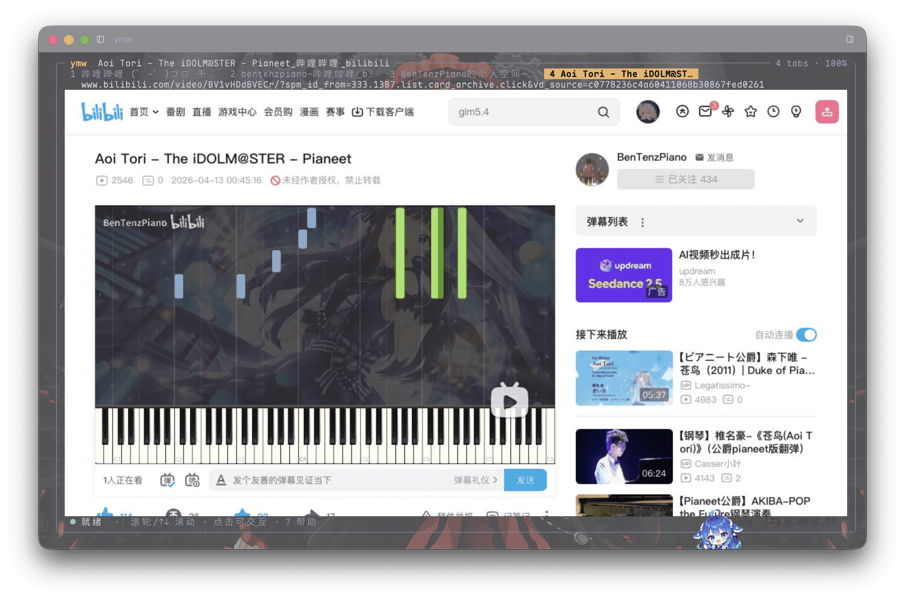

# ymw

macOS 终端里的浏览器。后台运行 headless Chromium 渲染页面，将截图通过 Kitty 图形协议写入终端，
因此显示的是真实网页内容：CSS、字体、图片与 JavaScript 均按浏览器的方式执行，而不是把 HTML 转成文本。

界面与同系列其他工具一致：整窗自适应的圆角框，快捷键全部为 `Ctrl + 字母/方向键`。



上图是 `ymw bilibili.com` → 搜索 UP 主并进入主页 → 点开视频详情页的过程，四个标签页同时存在。
页面是 Chromium 渲染后截图写进终端的，排版、字体、图片与视频画面均为真实渲染结果。

以下是界面的纯文本布局示意：

```
╭─ ymw  Example Domain ────────────────────────────────── 1 tab · 100% ─╮
│   example.com                                                         │
│                                                                       │
│                    Example Domain                                     │
│                                                                       │
│              This domain is for use in documentation                  │
│              examples without needing permission.                     │
│                                                                       │
│  ● 就绪  ·  滚轮/↑↓ 滚动 · 点击可交互 · ? 帮助        kitty  153.0…    │
╰───────────────────────────────────────────────────────────────────────╯
```

## 关于这个项目

- **由 AI 生成**：代码与文档由 AI 助手根据使用者提出的需求编写，人工负责需求、取舍与测试。
- **仅适配 macOS**：开发和验证都在 macOS（Apple Silicon）上进行，其他平台未经测试，不保证可用。
- **不提供支持**：没有精力处理 issue 与 PR。遇到问题或有额外需求，请自行 fork、修改、构建。
- **按现状提供**：MIT 许可，不附带任何形式的担保。

## 功能

- 页面由 headless Chromium 渲染，截图经 Kitty graphics 显示，保留原始排版与字体
- 连续帧：CSS 动画使用 `Page.startScreencast`；检测到 `<video>` / `<audio>` 播放时改用
  `captureScreenshot` 按 `--fps` 主动取帧（headless 的 screencast 对视频几乎不产帧）
- 帧以 JPEG 取回，解码为 raw RGB 后通过 Kitty 的 `t=s` 传输，pty 上每帧约 170 字节
- 新标签接管：页面 `window.open` 产生的新 target 会自动 attach 并切换，同时暂停原标签的媒体播放
- 音频由 Chromium 输出，视频站点有声音
- 多标签页：单个 Chromium 进程内多个 target，`Ctrl+1~9` 直选
- 地址栏：`Ctrl+L` 聚焦，输入网址或搜索词（无协议时补 `https://`，含空格则走搜索引擎）
- 前进 / 后退：`Ctrl+↑` / `Ctrl+↓`
- 缩放：`Ctrl+=` / `Ctrl+-` / `Ctrl+0`，通过修改 CSS 视口实现，不是放大位图
- 页内查找：`Ctrl+F`，使用 `window.find`
- 鼠标：左键点击页面元素，滚轮滚动，拖拽选中文字
- 页面输入：点击输入框后直接键入，`Esc` 退出输入状态
- 复制与粘贴：`Ctrl+Shift+C` 走 `pbcopy`，`Ctrl+Shift+V` 写入页面
- 引擎自备：`ymw --install-engine` 将引擎复制到 `~/.local/share/ymw/engine/`

## 安装

需要 Rust 工具链（`rustup` 或 Homebrew 的 `rust`）。

```bash
cd ~/Desktop/ymw
./install.sh          # cargo build --release，装到 ~/.local/bin/ymw
```

`install.sh` 会构建 release、复制到 `~/.local/bin`、清除 macOS 加在二进制上的
`com.apple.provenance` 属性（不清除会被内核以 SIGKILL 终止）。

> 更换位置：`YMW_INSTALL_DIR=/usr/local/bin ./install.sh`。

## 浏览器引擎

程序自身不包含浏览器内核，启动时按以下顺序查找可用的 Chromium：

1. `--engine /path/to/chrome-headless-shell`
2. 环境变量 `YMW_ENGINE`
3. 本机其他程序已下载的 `chrome-headless-shell`（常见于各类 Electron / 浏览器工具目录）
4. `/Applications/Google Chrome.app`、`/Applications/Chromium.app`
5. `PATH` 中的 `chrome-headless-shell` / `chromium` / `google-chrome`

`ymw --probe` 会显示最终选中的引擎。将引擎复制到自己的目录：

```bash
ymw --install-engine        # 复制到 ~/.local/share/ymw/engine/<版本>/，约 195MB
```

复制后优先使用这份副本，删除原有浏览器不再影响 ymw。

启动过程有三层自动处理，无需手动加参数：

1. 启动失败或沙盒报错（日志中出现 `sandbox initialization failed`、`GPU process isn't usable`）→ 自动追加
   `--no-sandbox` 重试
2. profile 被其他实例占用（`Failed to create a ProcessSingleton`）→ 改用临时 profile 重试
3. 运行中浏览器退出 → 引擎自动重启，并按原网址重建标签页

## 用法

```bash
ymw                                  # 打开起始页
ymw example.com                      # 直接打开网址（自动补 https://）
ymw "猫 表情包"                       # 含空格 → 交给搜索引擎
ymw --search 'https://www.bing.com/search?q=%s'      # 更换搜索引擎
ymw --zoom 1.2 example.com           # 初始缩放 120%
ymw --probe                          # 打印终端与引擎探测结果
```

## 命令行参数

`ymw [OPTIONS] [TARGET]`

| 参数 | 取值 | 默认 | 作用 |
| --- | --- | --- | --- |
| `[TARGET]` | 网址或搜索词 | 空（起始页） | 打开目标；无协议时自动补全 |
| `--home` | 网址 | 空 | 起始页地址，不填则使用内置起始页 |
| `--search` | 含 `%s` 的网址 | 百度 | 搜索模板，`%s` 替换为 URL 编码后的关键词 |
| `--engine` | 可执行文件路径 | 自动探测 | 指定 Chromium / chrome-headless-shell |
| `--profile` | 目录 | `~/.local/share/ymw/profile` | 用户数据目录（Cookie、缓存、登录态） |
| `--user-agent` | 字符串 | 普通 Chrome UA | 覆盖 UA，默认将 HeadlessChrome 替换为 Chrome |
| `--engine-arg` | 参数 | 无 | 追加 Chromium 参数，可重复 |
| `--no-sandbox` | 开关 | 关 | 关闭 Chromium 沙盒，仅受限环境需要 |
| `--zoom` | 0.25–4.0 | 1.0 | 初始缩放，界面内可用 `Ctrl+=/-/0` 调整 |
| `--fps` | 1–60 | 30 | 连续渲染的取帧上限 |
| `--frames` | `auto` `raw` `png` | `auto` | 帧传输方式，见下 |
| `--scale` | `auto` 或数字 | `auto` | 每个 CSS 像素对应的物理像素数；`auto` 在单元格高 ≥28px 时取 2，否则取 1 |
| `--install-engine` | 开关 | — | 复制引擎到 `~/.local/share/ymw/engine/` 后退出 |
| `-g, --graphics` | `auto` `kitty` `iterm` `blocks` `off` | `auto` | 页面的绘制方式 |
| `--cell-aspect` | 浮点数 | 自动探测 | 单元格高宽比，探测失败时使用 |
| `--probe` | 开关 | — | 打印终端能力与引擎路径后退出 |
| `--lang <LANG>` | `cn` `en` | `cn` | 界面语言；单独使用时只写配置、不启动界面 |
| `-h` | | | 简洁说明，每个参数一行 |
| `--help` | | | 完整说明：取值、默认值、示例 |
| `-v` / `-V` | | | 一行版本号 |
| `--version` | | | 完整信息：构建目标、引擎查找顺序、终端要求 |

### 命令行约定

同系列四个工具（ymp / ymw / ymi / ymv）使用同一套约定：

| 写法 | 作用 |
| --- | --- |
| `-h` | 简洁说明，每个参数一行 |
| `--help` | 完整说明：取值、默认值、示例、退出码 |
| `-v` / `-V` | 一行版本号 |
| `--version` | 完整信息：构建目标、后端、终端要求、许可 |
| `--lang <LANG>` | 界面语言，`LANG` 取 `cn` 或 `en`。单独使用时只写入配置并退出，不启动界面；`--lang en`、`--lang=en`、`--language en` 等价，写错会报错 |

说明文字默认中文，`--lang en` 切换为英文，不混排。`--lang` 的值会校验：
写错（例如 `--lang xx`）直接报错并指出可选值，不会静默退回中文；带尖括号或引号（`--lang <en>`、`--lang "en"`）会被自动去掉。

### 补充说明

- **`--search`**：模板中的 `%s` 为替换位。判定规则是“不含空格且带点号或冒号”视为网址，否则视为搜索词。
  起始页输入框使用同一规则：`bilibili.com` 直接打开，`bilibili` 走搜索。
- **`--profile`**：需要干净会话时用 `--profile /tmp/ymw-test`，登录态与 Cookie 不会串。
- **`--frames`**：`auto` 在 kitty 且非 SSH/tmux 时用 `raw`（共享内存），否则用 `png`。
  画面空白或错乱时先试 `--frames png`，以排除共享内存路径。
- **`-g blocks`**：终端不支持图片时以半块字符渲染截图，仅作兜底。
- **`--no-sandbox`**：正常 macOS 环境不需要；检测到沙盒失败时会自动追加。

## 配置

配置文件：`~/.config/ymw/config`（设置了 `XDG_CONFIG_HOME` 时改用 `$XDG_CONFIG_HOME/ymw/config`）。

```
# ymw preferences
lang = en
```

- 只切换语言、不启动界面：`ymw --lang en`。目录不存在会自动创建，写完后立即退出
- 不带 `--lang` 时读取该文件；文件不存在或没有 `lang` 项时使用中文
- `--lang` 与 `-h` / `--version` 同时出现时只影响本次输出，不写入文件
- 未知键会被忽略，旧版本读到新版本写的文件也不会报错

## 快捷键

全部为 `Ctrl + 字母/方向键`，不含 `Command` 组合，避免与终端 App 的快捷键冲突。

| 键 | 作用 |
| --- | --- |
| `Ctrl+L` | 聚焦地址栏（内容全选，输入即替换） |
| `Ctrl+T` | 新建标签页并聚焦地址栏 |
| `Ctrl+W` | 关闭当前标签页（最后一个关闭后退出） |
| `Ctrl+1`~`Ctrl+9` | 切换到第 N 个标签页 |
| `Ctrl+←` / `Ctrl+→` | 上一个 / 下一个标签页 |
| `Ctrl+↑` / `Ctrl+↓` | 后退 / 前进 |
| `Ctrl+R` | 刷新（忽略缓存） |
| `Ctrl+F` | 页内查找，回车跳下一处，`Esc` 关闭 |
| `Ctrl+A` | 全选页面内容 |
| `Ctrl+Shift+C` | 复制选中文字到系统剪贴板 |
| `Ctrl+Shift+V` | 将系统剪贴板内容粘贴进页面 |
| `Ctrl+=` / `Ctrl+-` | 放大 / 缩小 |
| `Ctrl+0` | 重置缩放 |
| `Ctrl+Q` / `Ctrl+C` | 退出 |
| `Esc` | 取消输入 / 页面元素失焦 |
| `↑` `↓` `PgUp` `PgDn` | 滚动页面（`j k u d g G` 同效） |
| 鼠标左键 | 点击页面元素、切换标签页、点地址栏编辑 |
| 鼠标拖拽 | 选中网页文字 |
| 鼠标滚轮 | 滚动页面 |
| `?` | 帮助浮层（`Shift+/`）。页面正在输入时不触发，先 `Esc` 退出输入再按 |

**页面输入**：点击输入框后键盘直接输入给网页（状态栏显示“页面输入中”），`Esc` 退出输入状态。

## 工作原理

```
ymw (TUI)
  │  Ctrl+L 输入网址
  ├──> CDP 请求 ──> chrome-headless-shell
  │                   ├─ Target.createTarget / setDiscoverTargets
  │                   ├─ Page.navigate / reload / navigateToHistoryEntry
  │                   ├─ Emulation.setDeviceMetricsOverride  (像素尺寸 + 缩放)
  │                   └─ screencast / captureScreenshot → JPEG
  └──< JPEG ─────────┘
        │  解码成 RGB
        └──> 写入 POSIX 共享内存 → kitty APC `a=T,f=24,t=s,S=<字节数>,z=-1100000000`
```

实现要点：

- **传输走 `--remote-debugging-pipe`**：命令写 fd 3、回复读 fd 4，JSON 以 `\0` 分隔。不开放调试端口，
  外部进程无法连接，比 `--remote-debugging-port` 更可控。
- **截图尺寸等于内容区像素尺寸**：例如单元格 9×19 像素、内容区 116×30 格，视口即设为 1044×570，
  截图直接贴图，不做二次缩放。
- **缩放通过修改 CSS 视口**：`width = 像素宽 / (scale × zoom)`、`deviceScaleFactor = scale × zoom`，
  页面按窗口变窄重新排版，文字保持清晰。
- **JPEG + 共享内存**：Chromium 生成一张 900×550 的 PNG 约需 60ms、470KB；JPEG 约 30ms、80KB。
  将 JPEG 解码为 RGB 后写入共享内存，终端无需解码，pty 上每帧仅几十字节。
- **重绘不闪**：图像 id 与 placement 保持不变，重发同一 id 由终端原地替换像素；仅几何变化时重新放置。
  图片按自身比例居中，窗口尺寸变化的过渡帧只留黑边，不会拉伸。
- **新窗口即新标签**：`Target.setDiscoverTargets` 在页面 `window.open` 时报告新 target，自动 attach 并切换，
  同时暂停原标签的媒体播放，避免声音叠加。
- **退出时回收进程组**：先发 `Shutdown`，再对浏览器进程组发送 `SIGTERM` / `SIGKILL`，
  渲染与音频子进程一并回收。

## 与普通浏览器的差异

可用的部分：页面由真实 Chromium 渲染，视频可播放、有声音、可拖选文字、可复制粘贴、可登录。
在本机 110×34 的终端中，640×360 视频约 17fps，pty 流量约 2.4KB/s（像素经共享内存传输）。

若文字大小不合适，先看 `ymw --probe` 中的 `cell size`：单元格高 ≥28px 时 `--scale` 自动取 2，
不匹配时手动指定 `--scale 1` 或 `--scale 2`。

主要差异：

- **无 DRM**：Netflix、Spotify 等需要 Widevine 的站点无法播放（Chrome for Testing 不含 Widevine）
- **无下载管理**：点击下载链接不会弹出保存对话框
- **无扩展、无开发者工具**
- **鼠标悬浮（hover）不可用**：终端只转发点击与拖拽，不转发悬停轨迹
- **滚动是整页跳转**，不是平滑滚动
- **帧率有上限**：默认 30fps；本机测试中视频约 17fps，瓶颈在 Chromium 截图环节
- **共享内存不能跨 SSH**：远端会话自动退回 `--frames png`，带宽与 CPU 占用明显上升
- **依赖终端画图能力**：没有图片协议支持时只能退化为半块字符
- 超大 DOM 或重型 WebGL 页面单帧截图较慢（普通页面 20–80ms）

## 排查

```bash
ymw --probe                        # 终端支持什么、引擎是否找到
tail -f ~/.local/share/ymw/profile/chrome.log   # Chromium 自身日志
ymw --profile /tmp/ymw-fresh       # 全新配置，排除缓存与 Cookie 干扰
ymw --no-sandbox                   # 受限环境中手动关闭沙盒
ymw -g kitty                       # 终端不回报能力时强制 Kitty
ymw --selftest                     # 引擎自检：截图流、拖选、音频
ymw --selftest https://站点         # 附带网址时还会点击播放并采样 video.currentTime
```

启动失败时，状态栏与终端会输出 `chrome.log` 的末尾若干行。

常见报错：

| 现象 / 报错 | 含义 |
| --- | --- |
| `Remote debugging pipe file descriptors are not open` | 调试管道的 fd 被复用，已修复 |
| `sandbox initialization failed` / `GPU process isn't usable` | Chromium 沙盒无法启动，会自动加 `--no-sandbox` 重试 |
| `Failed to create a ProcessSingleton` | 另一实例占用 profile，会自动改用临时 profile |
| 一帧都不出且无报错 | 终端不支持图片，用 `ymw --probe` 查看 kitty 一项 |
| 画面空白或错乱，但 probe 显示 kitty 可用 | 终端未实现共享内存传输，用 `ymw --frames png` |
| 点开视频或搜索后画面不动、声音仍在响 | 新标签未被接管，用 `ymw --version` 确认版本 |
| `Ctrl+1~9` 无反应 | 终端不支持 kitty 键盘协议（见 `ymw --probe` 的 `kitty keyboard`），可改用 `Alt+1~9` 或 `Ctrl+←/→` |
| 搜索页只有搜索框、没有结果 | 搜索引擎在 headless 下返回了空页，可换 `--search` 模板 |
| `?` 的帮助被页面挡住，只见边框见不到字 | 终端未实现 `z` 负值分层（见下节），页面被画在文字之上 |

## 实现

```
src/
  main.rs          入口 / --probe / --render（离屏渲染，开发用）
  cli.rs           参数定义、帮助与语言
  i18n.rs          中英文文案
  app.rs           状态机：标签页、地址栏、焦点、按键与鼠标、帧调度
  ui.rs            圆角框布局：标签条 + 地址栏 + 页面 + 状态栏
  engine/
    chrome.rs      引擎探测与安装
    cdp.rs         remote-debugging-pipe 传输 + 按 id 匹配的调用
    mod.rs         引擎线程：标签页、导航、缩放、输入、截图
  graphics.rs      Kitty / iTerm2 / 半块字符三种绘制方式
  term.rs          终端能力探测与 raw mode 进出
  theme.rs         配色
```

### 画面与文字的层次

Kitty 协议默认把图画在文字**之上**，这会让任何浮层（帮助、输入框）都被页面盖住。因此页面画面以
`z=-1100000000` 放置：

- 负值表示画在文字之下，`-1100000000` 低于规范里的 `INT32_MIN / 2`，于是还落在**有非默认背景色的单元格**
  之下。帮助面板用实底背景，正好把这一块画面遮住，看起来就是一个普通浮层。
- 面板以外的区域背景是默认色，画面照常透出，并且**继续刷新**——打开帮助不需要把页面撤下，关闭时
  也没有需要恢复的东西。
- 未实现 `z` 的终端会把画面画在文字之上，表现为帮助只露出边框、文字被页面盖住。

## 分发

| 方式 | 命令 | 前提 |
| --- | --- | --- |
| 免编译包 | 解开 `ymw-<版本>-<arch>.tar.gz`，`cp ymw ~/.local/bin/`，再 `xattr -c` | 无 |
| crates.io | `cargo install ymw` | 已安装 Rust |
| 源码仓库 | `cargo install --git https://github.com/masakiyuizzz/ymw` | 已安装 Rust |
| 自行构建 | `./install.sh` | 已安装 Rust |

```bash
./release.sh        # -> dist/ymw-<版本>-<arch>.tar.gz（含 README、LICENSE、INSTALL.txt）
```

脚本只构建当前架构。为 Intel Mac 打包需在该架构上执行，或
`rustup target add x86_64-apple-darwin` 后交叉编译。

> 从浏览器下载的二进制带 quarantine 属性，直接执行会被系统终止（`Killed: 9`，退出码 137），
> 因此 `xattr -c` 是必需步骤。

## 许可

MIT，见 [LICENSE](LICENSE)。
